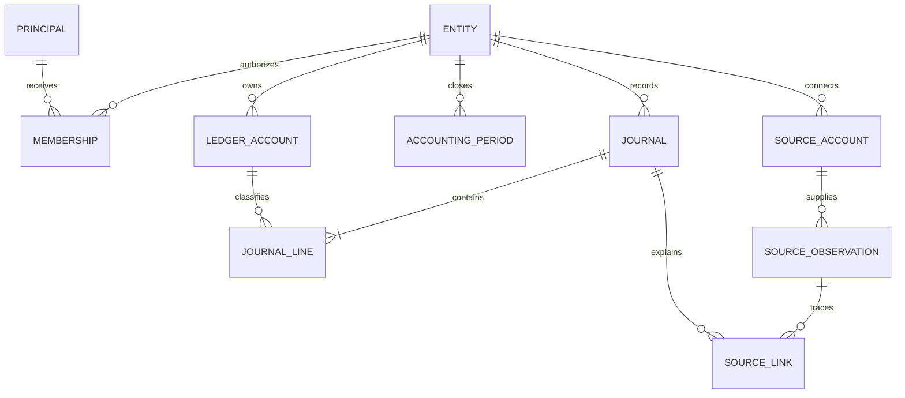

# Database design contract

## Decision and status

Design before product DDL. This is a proposed logical model and review standard,
not an approved physical schema. JB-001 resolves accounting policy; JB-002 owns
the first schema review. [Accounting invariants](accounting.md) remain authoritative.

## Logical relationships

An entity owns separate books. A bank/provider account is a source of observations;
a ledger account is an accounting classification. Never collapse those concepts.
Journal lines reference ledger accounts in the same entity as their journal.

This omits proposed audit/idempotency/outbox tables and reconciliation details;
cardinality alone does not enforce balanced entries or authorization.

## Required physical specification per table

Document purpose/owner, row grain, primary/business keys, every column's SQL type,
nullability, default, meaning and allowed values. Specify entity-scoped foreign
keys, unique/check constraints, lifecycle/deletion, sensitive fields, access roles,
retention, indexes justified by named queries and expected cardinality. Use
`snake_case`; distinguish accounting `date` from operational `timestamptz`.
Decide exact money representation, currency rules and rounding before columns
are approved. Do not use float or assume a fixed two-decimal world.

## Required operation specification

For posting, reversal, reconciliation and close, record:

1. Trusted caller, entity permission and operation inputs.
2. Preconditions and state transitions, including revoked access and closed periods.
3. Transaction isolation, lock order, retryable SQLSTATEs and bounded retry policy.
4. All writes and their atomic boundary, idempotency scope and payload comparison.
5. Result/error semantics, audit/source evidence and allowed subsequent operations.

Posting must not expose an intermediate unbalanced journal. Ordinary row CHECKs
cannot enforce cross-row balancing. JB-002 must choose and prove the owned write
boundary, privileges and any deferred constraint triggers. Cross-entity references
must fail in PostgreSQL, not merely in UI validation. Intercompany movements
require linked entries in separate books, never a mixed-entity journal.

## Review and acceptance matrix

| Contract evidence | Named future test |
| --- | --- |
| Entity keys, references and grants | `TestEntityReferencesAndPrivileges` |
| Exact money and balanced atomic posting | `TestPostingInvariants` |
| Concurrent idempotent requests | `TestPostingReplayConcurrency` |
| Posted immutability and linked correction | `TestJournalCorrectionHistory` |
| Posting versus close lock protocol | `TestPostingCloseRace` |
| Golden-month reports and reconciliation | `TestGoldenMonth` |
| Old/new application compatibility | `TestSchemaCompatibility` |

These are requirements, not implemented tests. SQL must be reviewed with example
queries and `EXPLAIN` evidence when data volumes make plans meaningful. An ERD or
successful migration is not acceptance evidence for accounting behavior.

## Done when and blockers

JB-002 is ready when reviewed column dictionaries, operation contracts, role
matrix, invariants and named test cases cover the first slice. Blockers: accounting
basis, initial currency, opening balances, timezone, permission model and precise
posting enforcement mechanism. Then create product migrations and their tests.
