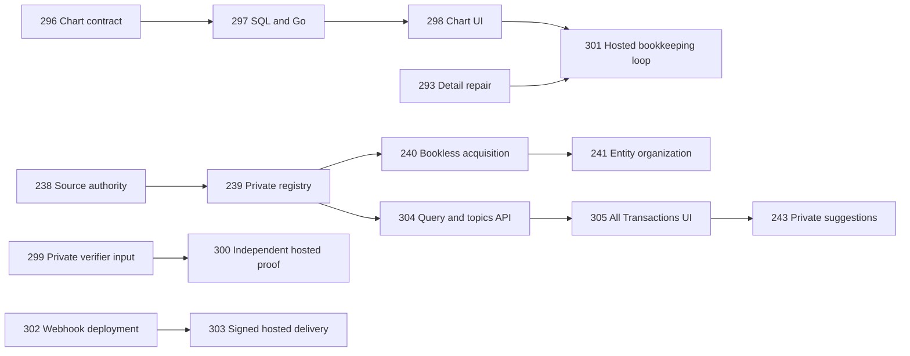

# Bookkeeping delivery and qualification plan

Planning snapshot 2026-10-24; parent [#50](https://github.com/justin-napolitano/jayburd-bookkeeping/issues/50),
agent registry [#65](https://github.com/justin-napolitano/jayburd-bookkeeping/issues/65).
GitHub owns current status, blockers and leases. This document owns delivery
sequence and acceptance boundaries; it does not dispatch agents or authorize releases.

## Starting evidence

The [actual Tartan run](../runbooks/tartan-browser-qualification.md) registered
nine supported sources, opened nine inboxes with 46 visible rows and completed
one savings repeat at demand 2/2 with six rows unchanged. Cards, student,
mortgage and auto transaction bindings were included. Five other discovered
types remained explicitly unbound. These observations do not qualify every
account type, the Liabilities product, a complete ninety-day interval, exact
financial equality or zero automatic journals. Do not fabricate bindings for
unsupported types; adding each type requires a reviewed accounting/data contract,
currency/permission/replay fixtures and a bounded child of [#104](https://github.com/justin-napolitano/jayburd-bookkeeping/issues/104)/#70.

Migration31 and verifier SQL bootstrap are accepted; the app recovery release
works with finite configuration. [#281](https://github.com/justin-napolitano/jayburd-bookkeeping/issues/281) still owns durable availability after
optional consent expires. The observed source-consent end is 2026-10-24T23:00Z;
recheck authority before any later provider action. There is no renewal in this plan.

Current-period transaction details and category forms load. Existing test books
lack expense/revenue accounts, so no legitimate expense draft or posting was
submitted. Earlier-period detail can disappear after category lookup failure.
No successful hosted category/post/report loop or independent four-row verifier
result is claimed. Dashboard metadata reported **Production approved**; [#274](https://github.com/justin-napolitano/jayburd-bookkeeping/issues/274)
still owns app-specific applicability, and runtime remains Sandbox. Do not submit
another Production request merely because internal qualification remains open.

Some foundations already exist: `TestGoldenMonth`,
`TestFinancialReportsGoldenMonth`, `TestSpotReversalHistoricalProvenance`,
`TestReversalOfReversalDenied` and browser `TestSyncReviewPostJourney`.
Open issues require clause-by-clause evidence reconciliation before deciding
which tests/features are actually missing. A test name, closed predecessor or
successful deployment cannot substitute for the exact acceptance case.

## Outcomes and order

1. Make the current book-based workflow usable and resilient; add legitimate
   accounts and prove an explicit synthetic category-to-report loop.
2. Deliver the already agreed connect-first architecture: private account/history
   registration before books, All Transactions, topics/strategies and reviewed
   organization into entity books. Source identity stays stable.
3. Complete applicable Plaid, privacy, security and recovery qualification with
   independent expectations and truthful evidence. Run independent lanes alongside
   product work where paths and authority do not overlap.
4. After the live gate and a concrete owner grant, qualify one read-only account.
   Official books require additional reconciliation, accounting and cutover gates.



This diagram shows selected critical chains; the tables and native GitHub
relationships include additional review and integration gates.

### A. Immediate product repairs and a complete fictional workflow

Relative estimates below are Fibonacci sizes, not time promises. H/M/L denote
confidence in scope. READY means eligible for a bounded claim after a fresh
GitHub/path check; it does not mean a lease exists.

| Issue | Bounded delivery and acceptance | Dependency / readiness | Size |
| --- | --- | --- | --- |
| [#281](https://github.com/justin-napolitano/jayburd-bookkeeping/issues/281) | Expired optional enrollment authority disables only unauthorized capabilities; baseline identity, ledger and recoverable commands remain available. Injected-clock before/at/after/restart, malformed-config fail-closed and real synthetic full-stack recovery. Never extend consent implicitly. | READY; review capability contract before code | 5 M |
| [#289](https://github.com/justin-napolitano/jayburd-bookkeeping/issues/289) | Distinct auth-config loading, retryable failure and invalid configuration; delayed success/retry/abort/logout tests, verified MFA and memory-only session preserved. | READY; separate auth files | 3 H |
| [#291](https://github.com/justin-napolitano/jayburd-bookkeeping/issues/291) | GET failure means read unavailable; POST unknown result retains same-command reconciliation. Test unavailable pending discovery never enables new mutations. | READY; owns API error mapping, coordinate UI consumers | 3 M |
| [#293](https://github.com/justin-napolitano/jayburd-bookkeeping/issues/293) | Preserve authorized detail when non-auth category lookup fails; lock draft with reason. Clear sensitive state on denial/book/session change, reject stale responses; investigate earlier-period cause. | READY; ReviewInbox exclusive | 3 M |
| [#290](https://github.com/justin-napolitano/jayburd-bookkeeping/issues/290) | Recognizable institution/account labels, distinguish duplicate cards, missing labels and discovered/unbound types. Minimize metadata under reviewed privacy/API rules. | Design READY; no implicit metadata/DDL expansion | 3 M |
| [#226](https://github.com/justin-napolitano/jayburd-bookkeeping/issues/226) | History coverage versus book period versus posting date; historical review remains readable, posting obeys policy. Bound larger-window capacity, no truncation/cursor loss. | Audit [#225](https://github.com/justin-napolitano/jayburd-bookkeeping/issues/225) evidence first; serialize ReviewInbox work with [#293](https://github.com/justin-napolitano/jayburd-bookkeeping/issues/293) | 5 M |
| [#294](https://github.com/justin-napolitano/jayburd-bookkeeping/issues/294) / [#296](https://github.com/justin-napolitano/jayburd-bookkeeping/issues/296) | Reviewed account-add authority, account classes/normal sides, currencies, concurrency, command recovery and independent examples. | Contract READY; real chart policy stays [#1](https://github.com/justin-napolitano/jayburd-bookkeeping/issues/1) | 3 M |
| [#297](https://github.com/justin-napolitano/jayburd-bookkeeping/issues/297) | Restricted SQL/Go reviewed account addition, stable replay, audit and zero journals from chart changes. | Hard blocked [#296](https://github.com/justin-napolitano/jayburd-bookkeeping/issues/296); sole SQL writer | 5 M |
| [#298](https://github.com/justin-napolitano/jayburd-bookkeeping/issues/298) | Accounts and review entry points; review/register/execute/acknowledge account addition; refresh categories, keyboard/mobile and lost-response recovery. | Mocks after [#296](https://github.com/justin-napolitano/jayburd-bookkeeping/issues/296); integration after [#297](https://github.com/justin-napolitano/jayburd-bookkeeping/issues/297); serialize [#293](https://github.com/justin-napolitano/jayburd-bookkeeping/issues/293) | 5 M |
| [#301](https://github.com/justin-napolitano/jayburd-bookkeeping/issues/301) / [#104](https://github.com/justin-napolitano/jayburd-bookkeeping/issues/104) | Source -> legitimate category -> balanced reviewed draft -> explicit post -> acknowledgement -> source/journal/GL/trial/P&L/balance sheet. Independent expectations, dropped committed reply yields exactly one effect. | After [#298](https://github.com/justin-napolitano/jayburd-bookkeeping/issues/298) and [#293](https://github.com/justin-napolitano/jayburd-bookkeeping/issues/293); audit [#84](https://github.com/justin-napolitano/jayburd-bookkeeping/issues/84) / existing journey first | 5 M |
| [#84](https://github.com/justin-napolitano/jayburd-bookkeeping/issues/84) | Statement-to-ledger golden month, independent expected money/counts, two entities, fees/refunds/transfers/duplicates/timing and mutation probes. | Existing corpus/report tests are inputs; identify missing import/reconciliation proof | 5 M |
| [#10](https://github.com/justin-napolitano/jayburd-bookkeeping/issues/10) / [#51](https://github.com/justin-napolitano/jayburd-bookkeeping/issues/51) / [#53](https://github.com/justin-napolitano/jayburd-bookkeeping/issues/53) | Reconcile full fictional interval; adjustment/close/correction contract and reviewed exports tied to immutable journals. | Audit shipped reports; design close before implementation; [#1](https://github.com/justin-napolitano/jayburd-bookkeeping/issues/1)/#2 policy for official use | 8 L |

The hosted loop explicitly posts only fictional reviewed work. Keep it separate
from [#300](https://github.com/justin-napolitano/jayburd-bookkeeping/issues/300), whose oracle requires zero journals. [#1](https://github.com/justin-napolitano/jayburd-bookkeeping/issues/1) does not prevent
synthetic UI repairs under the existing development policy; it does prevent
assuming that development policy approves real entity books.

### B. Connect first, review everything, organize later

Retain [#237](https://github.com/justin-napolitano/jayburd-bookkeeping/issues/237)
as this epic. Its proposed [decision](../decisions/0006-source-first-workspace.md)
and [authority contract](../contracts/source-first-workspace.md) remain subject
to [#238](https://github.com/justin-napolitano/jayburd-bookkeeping/issues/238) review; this plan does not silently accept their material policy choices.

| Issue | Delivery / named evidence | Hard integration gates | Size |
| --- | --- | --- | --- |
| [#238](https://github.com/justin-napolitano/jayburd-bookkeeping/issues/238) | Principal-private Item/account/observation ownership; legal-owner effective dates, disposition/grants/revocation/retention and existing-bound-Item migration. API/SQL authority matrix and fixed two-LLC/mixed-use/denied/reconnect/correction fixtures. | Contract review before implementation; accounting policy only where applicable | 5 M |
| [#239](https://github.com/justin-napolitano/jayburd-bookkeeping/issues/239) | Private pre-book registry; duplicate/revision/revoke/reconnect/migration and no-journal tests. No fake holding book. | [#238](https://github.com/justin-napolitano/jayburd-bookkeeping/issues/238); sole SQL writer | 8 L |
| [#240](https://github.com/justin-napolitano/jayburd-bookkeeping/issues/240) | Verified bookless Link, one exchange, recoverable completion, automatic available history and incremental acquisition; truthful loading/coverage. No book required and no journal from acquisition. | [#238](https://github.com/justin-napolitano/jayburd-bookkeeping/issues/238) then [#239](https://github.com/justin-napolitano/jayburd-bookkeeping/issues/239) integration; existing [#187](https://github.com/justin-napolitano/jayburd-bookkeeping/issues/187)/#156/#164/#225 evidence reused | 8 L |
| [#241](https://github.com/justin-napolitano/jayburd-bookkeeping/issues/241) | Legal ownership and versioned source-to-book dispositions; create/select books during organization, immutable source identity and explicit correction after posting. | [#238](https://github.com/justin-napolitano/jayburd-bookkeeping/issues/238)/#239/#240; SQL writer serialized. Cross-entity posting additionally [#244](https://github.com/justin-napolitano/jayburd-bookkeeping/issues/244)/#1; explicit review hold may ship earlier | 8 L |
| [#242](https://github.com/justin-napolitano/jayburd-bookkeeping/issues/242) / [#304](https://github.com/justin-napolitano/jayburd-bookkeeping/issues/304) | Scoped All Transactions queries, bounded filters/pagination and versioned topic hierarchy/atomic bulk labels; 3,000 rows, principal denial, stale revision and posted-retag immutability. | [#238](https://github.com/justin-napolitano/jayburd-bookkeeping/issues/238)/#239, reviewed API/SQL; sole SQL writer | 8 L |
| [#305](https://github.com/justin-napolitano/jayburd-bookkeeping/issues/305) | Pre-book and assigned history, topic/strategy filters, bulk-label review and source/disposition/journal provenance; keyboard/mobile, denied/empty/error/loading and 3,000-row pagination. | Wire mocks after reviewed contract; integration [#304](https://github.com/justin-napolitano/jayburd-bookkeeping/issues/304) | 8 L |
| [#243](https://github.com/justin-napolitano/jayburd-bookkeeping/issues/243) | Attributed provider labels plus owner-private versioned rules and suggestions, override/abstention/provenance. No suggestion posts; private scope/stale-version/override tests. | [#238](https://github.com/justin-napolitano/jayburd-bookkeeping/issues/238)/#242; future learned model requires separate reviewed privacy/evaluation decision and independently labeled synthetic corpus | 5 L |
| [#244](https://github.com/justin-napolitano/jayburd-bookkeeping/issues/244) | Cross-entity allocation/intercompany policy alternatives, both-book authority, exact original/functional-currency examples, correction/replay and separate balanced books. | [#238](https://github.com/justin-napolitano/jayburd-bookkeeping/issues/238) then explicit owner/accountant [#1](https://github.com/justin-napolitano/jayburd-bookkeeping/issues/1) acceptance before adopting posting treatment | 5 L |
| [#246](https://github.com/justin-napolitano/jayburd-bookkeeping/issues/246) | Fixture-only connect-first prototype with source inventory, topics/strategies/suggestion provenance and book handoff; desktop/mobile/keyboard. | Independent of production SQL; design input only | 3 M |

Provider category, topic/strategy, suggestion, reviewed ledger category and posted
journal are distinct states. Organizing into entities must never move a posted
journal or duplicate a source observation. Same-entity progress need not wait for
cross-entity accounting policy; unsupported dispositions stay explicitly held.

Keep [#247](https://github.com/justin-napolitano/jayburd-bookkeeping/issues/247) as the focused Position/Ledger parent. Audit [#248](https://github.com/justin-napolitano/jayburd-bookkeeping/issues/248)/#249 delivered
contracts/screens against their remaining acceptance before changing code. [#250](https://github.com/justin-napolitano/jayburd-bookkeeping/issues/250)
direct Ledger and [#255](https://github.com/justin-napolitano/jayburd-bookkeeping/issues/255) Investigate consume authoritative read models/statuses;
they must not invent attention metrics or add unposted transactions to balances.
Scope these as separate 3–5 point claims after their contracts, with coordinator
ownership of navigation. [#251](https://github.com/justin-napolitano/jayburd-bookkeeping/issues/251) available-to-use remains proposed planning work,
not required to fix bookkeeping or prove a read-only pilot. [#59](https://github.com/justin-napolitano/jayburd-bookkeeping/issues/59) consolidation
and advanced FX are deferred; ordinary multicurrency accounting remains required.

### C. Plaid qualification and security

The [#88 matrix](plaid-88-test-matrix.md) remains the canonical test inventory.
For every row record PASS/PARTIAL/OPEN/BLOCKED/N/A with rationale, exact source,
fixture and independent expected outcome, command/action, runtime when relevant,
redacted result and defect issue. Nothing becomes PASS merely by being planned.

| Owner issue | Remaining bounded stages | Blocking evidence / size |
| --- | --- | --- |
| [#272](https://github.com/justin-napolitano/jayburd-bookkeeping/issues/272) / [#299](https://github.com/justin-napolitano/jayburd-bookkeeping/issues/299) | Review private identity-only pipe/bridge; immutable authored expected financial fields, strict tags/scopes, no verifier raw-evidence/bank-secret access. Synthetic transport/cleanup proof first. | READY design; migration31 not reapplied; 5 L |
| [#300](https://github.com/justin-napolitano/jayburd-bookkeeping/issues/300) | Separate controlled four-row single-checking case; <=60-minute hash/scope-pinned mandate, one task/retries0, exact equality and zero journals/outbox, revoke/delete exact inputs/remove idle job. | [#299](https://github.com/justin-napolitano/jayburd-bookkeeping/issues/299) plus fresh finite owner/cloud/provider scope; 3 L |
| [#271](https://github.com/justin-napolitano/jayburd-bookkeeping/issues/271) / [#302](https://github.com/justin-napolitano/jayburd-bookkeeping/issues/302) | Exact-image isolated HTTPS receiver, actual restricted SQL/workload identity and caller/ingress/least-privilege verification; release/rollback receipt. | Preparation READY; actual release needs concrete reviewed scope; 5 L |
| [#303](https://github.com/justin-napolitano/jayburd-bookkeeping/issues/303) | Real signed delivery -> durable demand -> task/worker -> publication, duplicates/reordering/missed-event cases and no journals. | [#302](https://github.com/justin-napolitano/jayburd-bookkeeping/issues/302); exact W01–W07 dispositions, [#89](https://github.com/justin-napolitano/jayburd-bookkeeping/issues/89) for broad faults; 5 L |
| [#275](https://github.com/justin-napolitano/jayburd-bookkeeping/issues/275) | First bounded claim: modern session-proof contract and negative fixtures. Next separate implementation claim: owned SQL/Go association, retained token hash/attempt/Item generation, dedup and fenced repair. Then UI integration and actual reset_login/revoked/reduced-scope/lost-tab cases. Never use a second public-token exchange as reconnect proof. | Relevant [#271](https://github.com/justin-napolitano/jayburd-bookkeeping/issues/271) signed path before hosted repair. No current migration reservation; contract 3 M, implementation 8 L, hosted proof 3 L |
| [#276](https://github.com/justin-napolitano/jayburd-bookkeeping/issues/276) | Desktop OAuth then real iOS/Android mobile web installed/absent cases where applicable; return/cancel/expired/revoked/wrong-target/update-mode recovery, exact device/browser evidence. | Owned reconnect [#275](https://github.com/justin-napolitano/jayburd-bookkeeping/issues/275) for repair; owner device/login handoff. Viewport emulation is not physical-device proof; 5 L |
| [#274](https://github.com/justin-napolitano/jayburd-bookkeeping/issues/274) | Map actual Launch Center app/products/country/platform/registration requirements to every [#88](https://github.com/justin-napolitano/jayburd-bookkeeping/issues/88) row; explicit NEW_ACCOUNTS_AVAILABLE applicability. Record exclusions and owner attestations, not settings changes. | Read-only authenticated review; no new Production request implied; 3 M |
| [#85](https://github.com/justin-napolitano/jayburd-bookkeeping/issues/85)/#86/#87/#94 | Clause-level audit of sync lifecycle/fuzz/exact-money/isolation/signature/replay proofs; add only named missing cases with independent expectations. | Synthetic gaps READY after inventory; hosted cases stay distinct; 3–5 M per bounded gap |
| [#88](https://github.com/justin-napolitano/jayburd-bookkeeping/issues/88)/#104/#187 | Duplicate Item/account detection versus same-attempt replay; hosted exit/expiry/lost response, actual supported types, pending->posted/removal/pagination mutation/oversize/partial history, consent/revoke/retention evidence. | Each matrix row owns its fixture and scoped follow-up; L06 pass is narrow, R02/R03 remain open |

Before closing [#88](https://github.com/justin-napolitano/jayburd-bookkeeping/issues/88), coordinator audits **every** matrix row against linked
evidence, including supplemental persona fixtures and explicit N/A rationale.
If an acceptance row has no bounded existing owner, create a child under [#88](https://github.com/justin-napolitano/jayburd-bookkeeping/issues/88)
before dispatch; do not hide an unowned test in a checklist. Refresh cited
official sections before source-dependent design. Existing source records
[P88-01–17](../research/plaid-88-test-sources.md),
[Link recovery](../research/plaid-link-recovery-sources.md) and
[webhook release](../research/webhook-release-sources.md) record reviewed depth
and access limits; they are not a claim of current exhaustive documentation review.

### D. Operations, controlled personal accounts and official books

| Issue group | Plan and exit evidence | Gate |
| --- | --- | --- |
| [#64](https://github.com/justin-napolitano/jayburd-bookkeeping/issues/64)/#89 | Owner accepts workload/cost/SLO/RTO/RPO targets. Synthetic 1k/10k/100k events, 1/10/100 books, 1/2/4/8 workers; measure latency/throughput/resources, independent effects and noisy-neighbor bounds. Isolated restore, queue/cursor replay and fault recovery; exact cleanup. | Harness/audit READY; hosted soak needs budget/duration/scope. Proposed efficiency/latency numbers are not accepted SLOs. 5–8 L per bounded run |
| [#62](https://github.com/justin-napolitano/jayburd-bookkeeping/issues/62)/#56/#11/#164/#174/#154 | Audit actual MFA/current permission/revocation, secrets/KMS/federation/canonical-origin and retention/deletion/audit evidence. Reconcile shipped implementation with remaining operator setup; no secret/env/state reads. | Separate exact-path defects/receipts, human review of sensitive authority changes; 3–5 M per gap |
| [#58](https://github.com/justin-napolitano/jayburd-bookkeeping/issues/58)/#13 | Support incident contact, pause/revoke/rollback/restore playbooks, costs, retention, reconciliation and official-bookkeeping go/no-go. | Accepted targets and isolated recovery evidence; never overwrite a real ledger to test restore |
| [#90](https://github.com/justin-napolitano/jayburd-bookkeeping/issues/90) | One explicitly authorized read-only personal account: exact owner/entity/source/purpose/duration/audience/retention/budget/kill switch. Complete interval opening/closing statement reconciliation and explained discrepancies; disconnect/revoke/reconnect/delay recovery. | Existing [#90](https://github.com/justin-napolitano/jayburd-bookkeeping/issues/90) prerequisites remain: correctness/security/Sandbox/scale, [#1](https://github.com/justin-napolitano/jayburd-bookkeeping/issues/1), [#10](https://github.com/justin-napolitano/jayburd-bookkeeping/issues/10), [#27](https://github.com/justin-napolitano/jayburd-bookkeeping/issues/27) and privacy approval. Owner privately supplies records/credentials; agent evidence only redacted outcomes. 5 L |
| [#1](https://github.com/justin-napolitano/jayburd-bookkeeping/issues/1)/#2/#54/#60/#67/#17 | Owner/accountant basis/jurisdiction, entities, functional currencies, dates, opening balances, chart/loan principal-interest/card-payment/FX/rounding/correction policy. Audit existing invariant/reversal/corpus proofs; add independently expected gaps only. | Development policy supports synthetic work; real books/cross-entity treatment need explicit accepted policy |
| [#10](https://github.com/justin-napolitano/jayburd-bookkeeping/issues/10)/#51/#53/#13 | Full fictional month reconciliation/adjustment/close/correction plus reviewed traceable export, then limited real cutover plan. | Never mount deferred close route or call reports/accountant approval complete from builds |

## Foundation issue reconciliation

The roadmap covers remaining outcome work, not a rewrite of every open legacy
issue. No issue is closed by this planning change. At the next relevant claim,
compare each criterion to merged SHA, source contract and named evidence; split
a newly discovered gap and link it back. Keep canceled/missing predecessors
unresolved until explicitly dispositioned. These ownership groups prevent older
open issues disappearing from the plan:

Under #50/#132, review outstanding release/dependency PRs against current main
and their original authority before any merge. In particular, PR283's finite
renewal is not current release authority after the later app recovery; never
merge an expired approval just to clear the queue. PR181's dependency update
needs its own compatibility/CI review. This planning change neither merges nor
closes those PRs.

| Existing issues | Reconciliation owner and action |
| --- | --- |
| [#3](https://github.com/justin-napolitano/jayburd-bookkeeping/issues/3)/#12/#25/#26/#27/#39 | [#58](https://github.com/justin-napolitano/jayburd-bookkeeping/issues/58)/#62 audit build, synthetic-cloud, restricted SQL and real managed-identity evidence; exact new-head tests remain required for changes |
| [#7](https://github.com/justin-napolitano/jayburd-bookkeeping/issues/7)/#57/#100/#103/#156 | [#85](https://github.com/justin-napolitano/jayburd-bookkeeping/issues/85)/#87/#271 audit worker publication, fencing, outbox, signed ingress and multi-book dispatch; already published nine-source evidence is bounded |
| [#8](https://github.com/justin-napolitano/jayburd-bookkeeping/issues/8)/#55/#61/#70/#81/#82/#92/#93 | [#84](https://github.com/justin-napolitano/jayburd-bookkeeping/issues/84)/#237 audit source/import/staging contracts and implementation; preserve CSV and server-source authority during account-first migration |
| [#9](https://github.com/justin-napolitano/jayburd-bookkeeping/issues/9)/#50/#52/#80/#104/#132 | Product lanes A/B and [#88](https://github.com/justin-napolitano/jayburd-bookkeeping/issues/88) reconcile UI/enrollment/review/release acceptance; [#132](https://github.com/justin-napolitano/jayburd-bookkeeping/issues/132) release scope never implies all qualification complete |
| [#160](https://github.com/justin-napolitano/jayburd-bookkeeping/issues/160)/#186/#187 | [#104](https://github.com/justin-napolitano/jayburd-bookkeeping/issues/104) audit original completion/inspection defects against merged fixes and current actual recovery; don't close obsolete symptoms without exact original criteria |
| [#225](https://github.com/justin-napolitano/jayburd-bookkeeping/issues/225) | [#226](https://github.com/justin-napolitano/jayburd-bookkeeping/issues/226) verify dated-currency repair and original units; still-open issue is not evidence repair is absent |
| [#51](https://github.com/justin-napolitano/jayburd-bookkeeping/issues/51)/#53/#60/#67/#84/#86/#94 | Exact report/corpus/reversal/money evidence audit, independent expected results and missing probes; no redundant accounting engine |
| [#247](https://github.com/justin-napolitano/jayburd-bookkeeping/issues/247)/#248/#249/#250/#251/#255 | Focused workspace parent, accepted/proposed contract distinction, direct evidence navigation; planning metric remains separate |

## Parallel execution and leases

Maximum current team capacity is four active agents including coordinator: three
bounded implementation/design workers plus coordinator/reviewer. This is a
capacity ceiling, not four safely writable copies of the same app. No agents
are started or preassigned by this plan.

Suggested first wave: [#281](https://github.com/justin-napolitano/jayburd-bookkeeping/issues/281) startup/capability slice, [#289](https://github.com/justin-napolitano/jayburd-bookkeeping/issues/289) auth configuration
slice and [#296](https://github.com/justin-napolitano/jayburd-bookkeeping/issues/296) contract author, with coordinator reviewing contracts,
issue graph and shared files. [#238](https://github.com/justin-napolitano/jayburd-bookkeeping/issues/238) or [#246](https://github.com/justin-napolitano/jayburd-bookkeeping/issues/246) can replace a lane if immediate code
is blocked. Other ready tasks are queued rather than assigned overlapping paths.

Later waves: [#297](https://github.com/justin-napolitano/jayburd-bookkeeping/issues/297) is the sole SQL writer while [#293](https://github.com/justin-napolitano/jayburd-bookkeeping/issues/293) owns ReviewInbox
and [#238](https://github.com/justin-napolitano/jayburd-bookkeeping/issues/238) owns the source-first contract. Run [#291](https://github.com/justin-napolitano/jayburd-bookkeeping/issues/291) on API mapping only if exact
consumer edits are handed to the UI owner. [#226](https://github.com/justin-napolitano/jayburd-bookkeeping/issues/226)/#293/#298 and connection
labels/reconnect UI must serialize overlapping component writes. Run verifier
and webhook preparation alongside product work only with disjoint paths and
separate concrete execution mandates. Never run competing cloud mutations.

After [#238](https://github.com/justin-napolitano/jayburd-bookkeeping/issues/238), serialize SQL claims [#297](https://github.com/justin-napolitano/jayburd-bookkeeping/issues/297) -> [#239](https://github.com/justin-napolitano/jayburd-bookkeeping/issues/239) -> [#241](https://github.com/justin-napolitano/jayburd-bookkeeping/issues/241) or
[#304](https://github.com/justin-napolitano/jayburd-bookkeeping/issues/304) or [#275](https://github.com/justin-napolitano/jayburd-bookkeeping/issues/275) according to reviewed priority/dependency readiness;
this is writer scheduling, not an invented architectural dependency. Go/UI work
can proceed against reviewed contracts in separate paths. Migration numbers are
allocated only after a fresh main/lease check; earlier planned migration30/31
reservations are obsolete. All merged SQL stays immutable.

Each dispatch must record in [#65](https://github.com/justin-napolitano/jayburd-bookkeeping/issues/65) and the bounded issue:

```text
token / issue / owner / UTC start / heartbeat / expiry / status
base SHA / branch / worktree
exclusive exact paths (including shared-file handoffs)
reviewed dependency SHAs and unresolved acceptance gates
bounded outcome / non-goals / named tests / stage runbook
handoff SHA / results / limitations / successor authority
```

Use a proposed 60-minute renewable lease and heartbeat at meaningful stages,
at least every 15 minutes; future dispatcher must set actual UTC values.
Expired writers stop before edits and reconcile with coordinator. Expiry does
not authorize overwriting another worktree. Release ownership before another
writer starts; record review/integration separately from acceptance/completion.
Coordinator exclusively owns OpenAPI, generated types, navigation/global styles,
index/bibliography, CI/Makefile and schema fixtures unless exact files are
delegated. Shared-file ownership can be transferred explicitly, never inferred.

## Required delivery evidence

Every implementation PR links a bounded issue, exact parent/dependencies,
contract and stage runbook; states migration impact and unresolved risks; names
tests versus proposed cases. Before commit run staged runbook validation.
Run `make check`, `make test`, `make build`; add `migration-test` for SQL/tooling,
`ledger-test` for accounting, web check/test/build/browser for browser/API and
`app-integration` for browser/API/SQL changes. Use disposable synthetic databases.
Do not run the long foundation suite merely to replace these relevant gates.

Hosted evidence additionally pins source SHA, exact images/config/revisions,
finite authority, independent fixture expectation, actual action/result and
cleanup. Owner performs credentials/MFA privately. No raw payload, financial
record, statement, secret or browser token is published. For financial exchanges
record applicable ISO edition/message/profile/mapping/validation, and rationale
where no ISO financial message applies; exact money and multicurrency remain
required. Standards names, XSD validation and generator self-checks are not
ledger conformance or accounting approval.

Planning acceptance is a deduplicated issue graph and reviewable document.
Implementation completion, hosted qualification, live-account enrollment and
official-books approval each remain distinct recorded outcomes.
