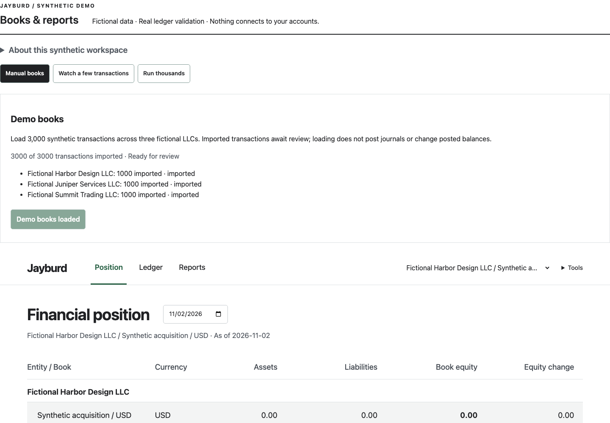
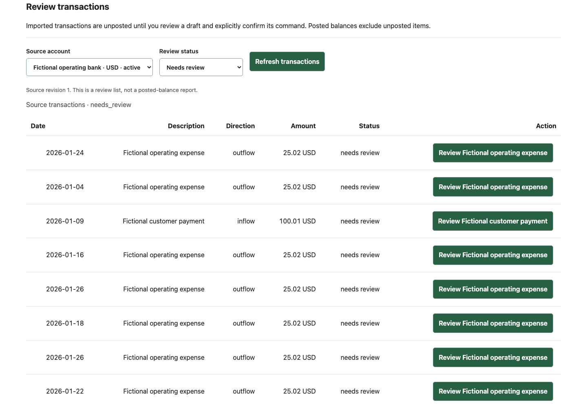
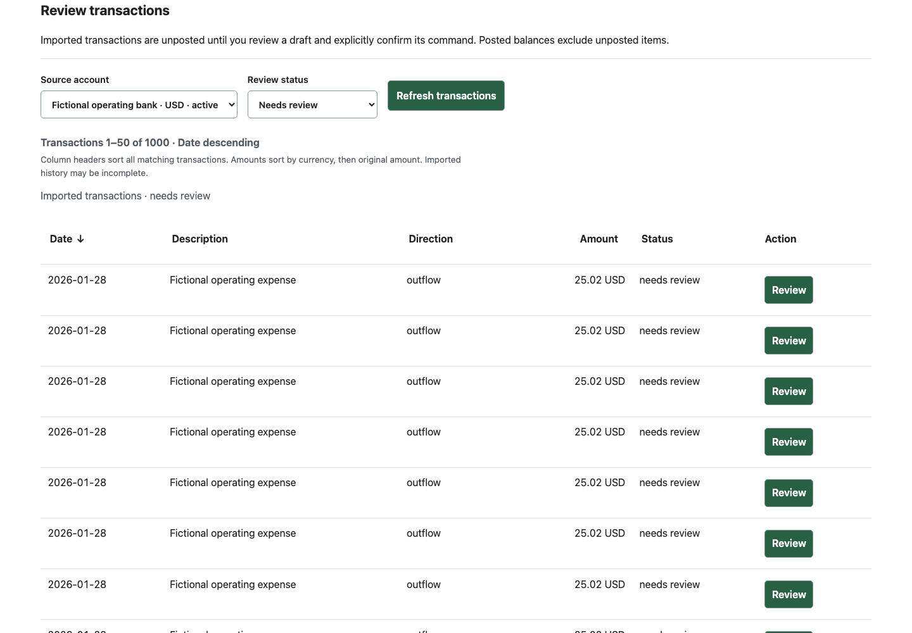
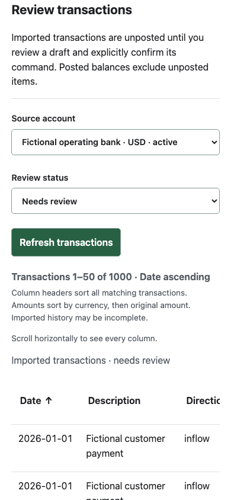
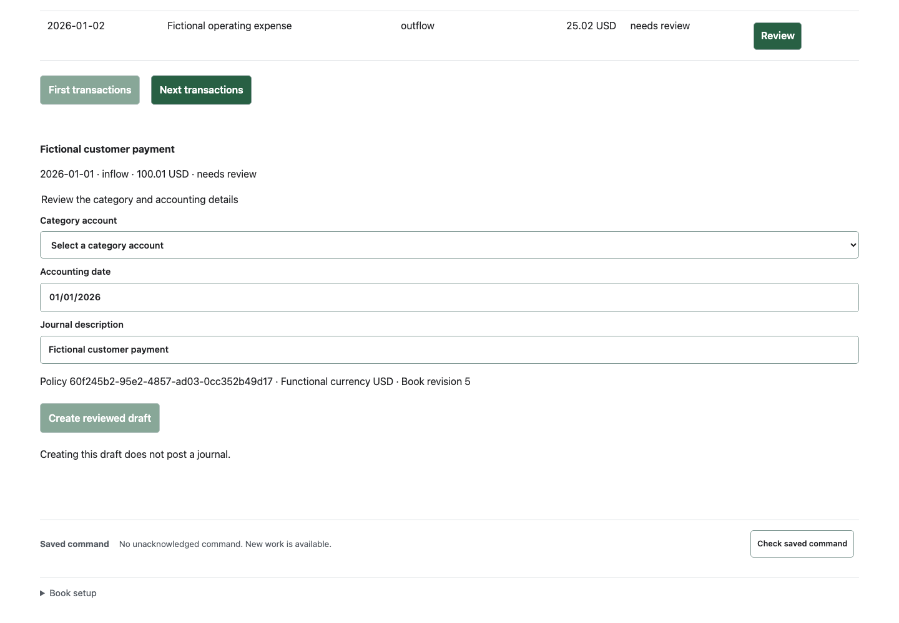
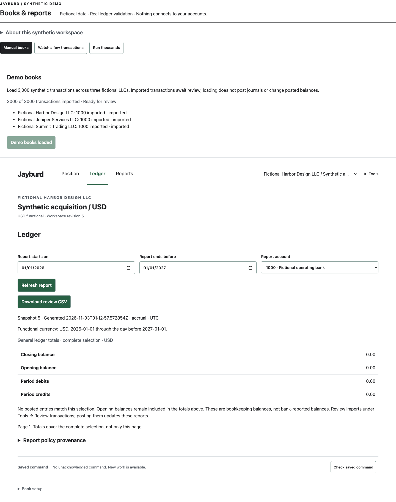
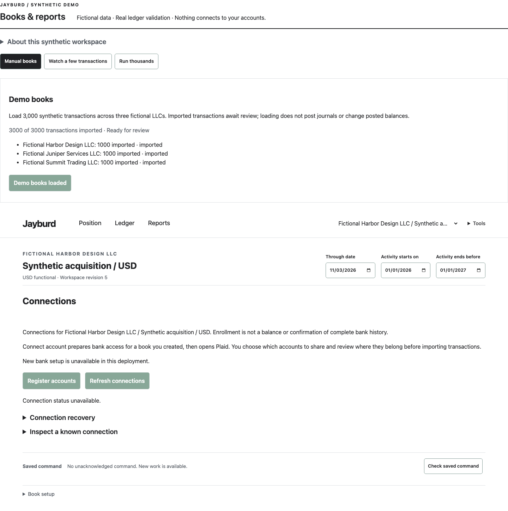
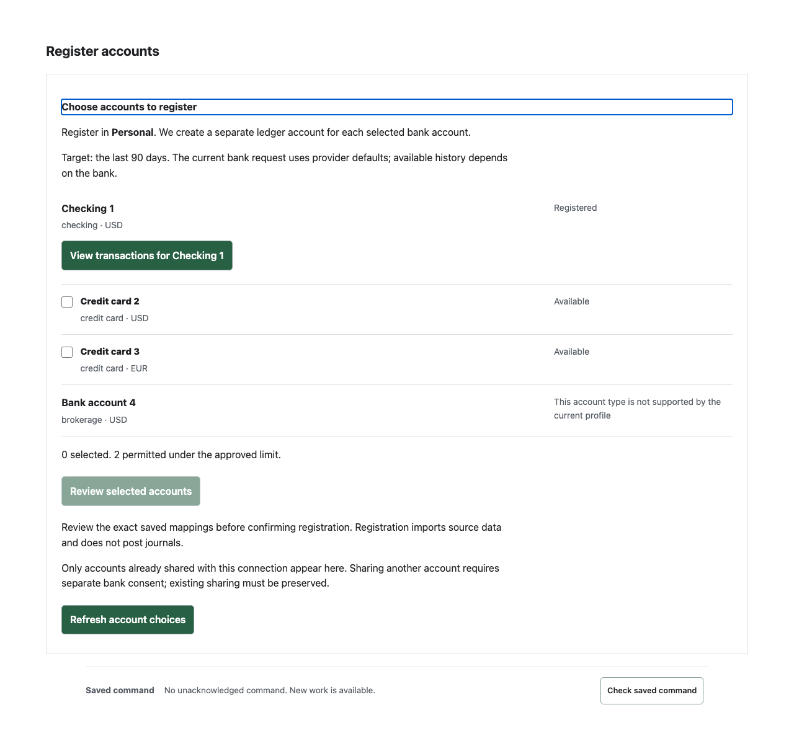

# Frontend review —406

Captured2026-11-02/03UTC with the owner-authorized Playwright browser against the
isolated synthetic demo; component screenshots use explicit synthetic API fixtures.
No Production DOM, provider calls, real records or private screenshots were used.
Desktop1440×1000, mobile390×844. Actual registration/provider authentication is
outside this review. Images were saved, opened and accepted; loading/failed early
captures were replaced. Demo-only generator chrome is not a Production feature.

The core flow works, but finding imports and understanding the distinction from
posted balances need improvement. This delivery fixes the transaction-list slice;
broader changes are bounded issues rather than an unreviewed whole-app redesign.

1. **Position → transaction entry — usable, hard to discover.** Book selection
   and Position/Ledger/Reports are prominent; Review transactions is hidden in
   Tools. The explicit book/currency context is a strength. High priority407 adds
   a clear existing-book transaction handoff without pretending cross-book queries
   are implemented. No bank balance can be inferred from these posted figures.
   

2. **Desktop transaction list — corrected in406.** Before: UUID order was invisible,
   descriptions inherited numeric alignment, long action labels duplicated the
   description, and disabled Next did not explain the end. Now: each data header
   requests global SQL ascending/descending order, dates default newest-first,
   original numeric amounts group by currency, rows read left-to-right and Review
   stays compact. Count/range, first/next controls and explicit end text explain
   pagination. All sorting occurs before the bounded page limit.
   
   

3. **Mobile transaction list — improved, deliberate horizontal table.** Date and
   money stay on one line; filters fit390px; the table owns horizontal overflow
   and names that interaction. Keyboard focus reaches the scroller and sortable
   headers; active sort has aria-sort. Long synthetic descriptions and no document
   overflow are browser-tested. A complete wide financial table is not visible at
   once; this is a disclosed scrolling design, not a mobile-card claim.
   

4. **Transaction details/draft — functional, still technical.** Source facts remain
   distinct from the category/accounting draft and explicit command confirmation.
   Focus follows the selected detail and original amount/date stay visible. Policy
   UUID/revision copy and an editable-looking date that must match the original
   date are confusing. Medium priority226 should make fixed dates/holds plain;
   actual existing-account availability repair remains404. No draft/post was
   performed during capture; separate full-stack tests prove explicit recovery.
   

5. **Posted Ledger/report empty state — clarified in406.** A zero posted ledger
   looked like a bank balance to the owner. The current empty state explicitly
   identifies bookkeeping totals, preserves opening-balance semantics and points
   to Tools → Review transactions. A real bank-reported balance feature has not
   been implemented or inferred.407 improves the direct handoff.
   

6. **Connections/selection/recovery — limited evidence.** The ordinary generated
   demo has no enabled provider runtime and correctly blocks setup; its status
   is unavailable. This is a named capture limit, not a provider failure or a full
   live-flow audit. The current component fixture separately exercises selection,
   saved review, explicit register/acknowledge, lost reply and mobile behavior;
   three actual browser/API/SQL journeys pass with synthetic identities. Existing
   labels290 and uncertain-read-versus-mutation guidance291 remain follow-ups.
   
   

## Follow-through and limits

High priority407: discoverable transaction entry/context; high priority408: scoped
description/date filters and honest available-import/sync coverage. They are
unclaimed planning, not completion of304/305's cross-book taxonomy.226 owns the
date/history explanation;290 recognizable provider labels;291 failure semantics;
404 already-registered account availability. Each keeps its current dependencies.

Evidence:367 frontend unit tests,30 browser cases, all three real Next→Go→SQL
synthetic journeys, core/migration/ledger gates and source SQL cases pass. One
3000-row source traversed30 unique pages in3.51s total on this disposable
PostgreSQL17 Docker fixture after cold-plan full-key lookups; no timeout increase,
ANALYZE prerequisite or hosted latency claim. Read/sort created no journals.
Runner metadata: Linux/aarch64,18 logical CPUs,8,319,213,568bytes Docker memory;
other verification ran concurrently. One run is not a production latency target.
This proves pagination, not bank history completeness or private value equality.

Accessibility evidence covers native table semantics, header aria-sort, keyboard
focus, overflow and390px behavior in Chromium. Screen-reader speech, browser/AT
combinations, complete contrast and full WCAG conformance were not assessed.
No live sign-in/MFA/OAuth/provider recovery, Sandbox consent renewal, actual restore
or Production account increase occurred. Source39 needs human review and a
separate migration-first rollout; the deployed site still runs38.
